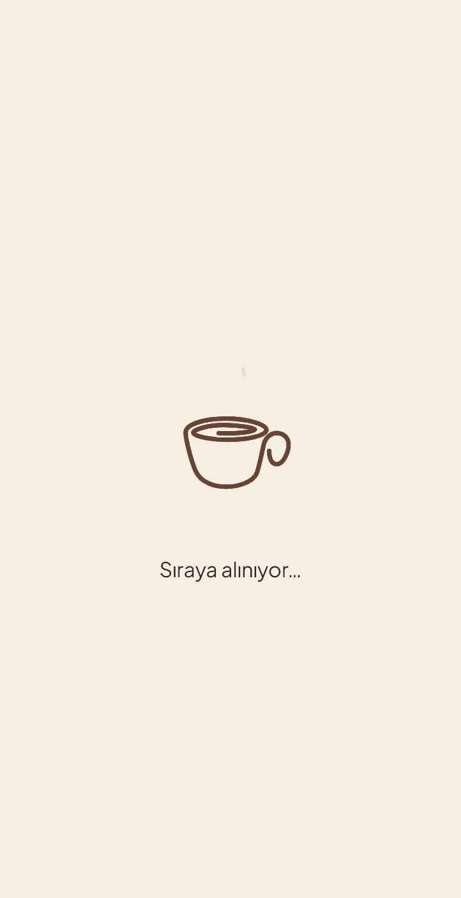
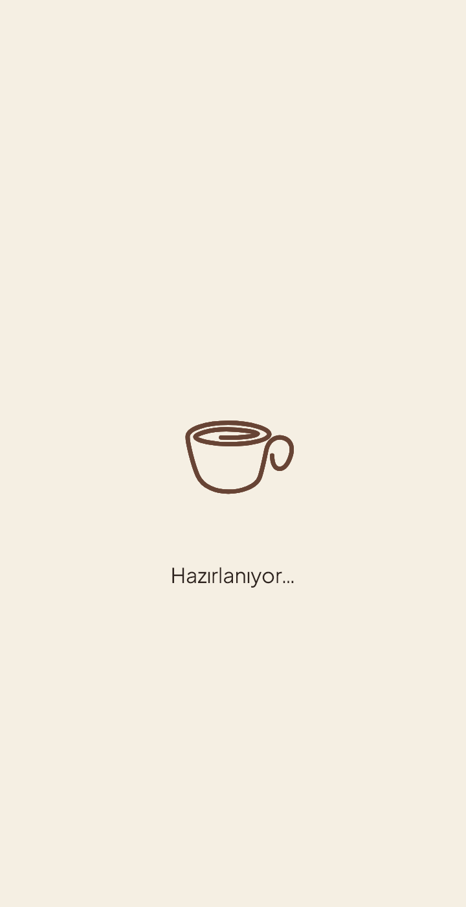

# V90 — Sade hazırlık ekranı ve orantılı kahve animasyonu

22 Ekim 2026 · Android test sürümü **1.0.0-kimi-test.90 (90)**.

## Kullanıcıya görünen değişiklik

**Falımı Oluştur** sonrasında fotoğraf ve işaretler hazırlanırken görünen kilitli inceleme ekranının yerini krem zeminde yalnız mevcut kahve/buhar animasyonu ve durum yazısı alır:

1. Kayıt aşamasında **Sıraya alınıyor…**.
2. Yerel inceleme ve görsel hazırlığında **Hazırlanıyor…**.
3. Mevcut hazır olma koşulları sağlanınca fotoğraflı **Fincanının Hikâyesi**, ardından normal sonuç akışı.

Yapay bekleme, yüzde veya yeni animasyon paketi yoktur. Durum değişirken animasyon kaldığı yerden devam eder. Alttaki inceleme ekranı dokunma ve erişilebilirlik açısından engellenir. Ağır yerel hazırlık başlamadan önce sade ekranın ilk karesi çizilir.

Sade ekranda görünür **Durdur** düğmesi bulunmaz; telefonun geri eylemi mevcut iptal işlemini bir kez çalıştırır. İptalde animasyon durur, mevcut güvenli durma mesajı kullanılır. Fotoğraflı aşamanın Durdur eylemi korunur.

## Ölçü ve erişilebilirlik

Animasyon kutusu, güvenli alandaki 16dp dış boşluk çıkarıldıktan sonra `min(clamp(genişlik × 0.52, 160, 220), yükseklik × 0.40)` ile ölçülür. Yatay/küçük ekranda yükseklik sınırı önceliklidir. Görsel gerilmez veya kırpılmaz; yazıyla arasında 16dp vardır. Yazı sistem ölçeğini korur. Hareket azaltmada mevcut sabit fincan karesi gösterilir.

`CoffeeLoadingAnimation.size` isteğe bağlıdır ve varsayılanı **72dp** kalır. Fotoğraflı hazırlık ekranındaki animasyon, fotoğraf boyutu, işaretler, sonuç geçişi ve Durdur görünümü değişmez.

| Sıraya alınıyor | Hazırlanıyor |
|---|---|
|  |  |

Görüntüler gerçek Flutter bileşenlerinden üretilmiş **360×700, normal yazı** test görüntüleridir. Telefon ekran görüntüsü değildir; PNG, oynayan animasyonun bir karesini gösterir.

## Değişiklik sınırı

V90 üretim değişikliği V89 (`0805879`) üzerine yalnız şu dosyalardadır:

- `atlas_contribution_app/lib/src/coffee_loading_animation.dart`
- `atlas_contribution_app/lib/src/fortune_preparation.dart`
- `atlas_contribution_app/lib/src/contribution_home.dart`

İki mevcut test genişletildi ve `v90_preparation_test.dart` eklendi. Yalnız Kaydet, kayıt/analiz sırası, veri modelleri, kayıt biçimleri, AI arayüzleri, kamera/OpenCV, Tarot, logo ve animasyon varlıkları V89'a göre değişmedi. Tamamlanmış kayıt korunur; başarısız işlem otomatik yeniden gönderim veya AI isteği başlatmaz.

Bu dal V90'ın tam kaynak anlık görüntüsüdür; daha önce yerelde tutulan V87 kaynak kontrol noktası ile V88/V89 Tarot dokunma yönlendirmesi commit'lerini de içerir. Bu önceki değişiklikler V90 için yeniden uygulanmadı. Ayrıntıları [V88](../../TAROT_V88_NOTLARI.md) ve [V89](../../TAROT_V89_NOTLARI.md) notlarındadır.

## Doğrulama

- **82 ilgili test geçti:** hazırlık katmanı, animasyon, kayıt akışı, yerel inceleme, izler ve veri deposu.
- Ek kayıt kurtarma/AI arayüzü grubunda **8 test geçti, 1 test başarısız**.
- **Flutter analyze: No issues found.** Diff boşluk kontrolü temiz.
- 360/412×700, 320×480 ve 700×320 ekranlarda normal ve iki kat yazı: sade ekranda taşma, kesilme veya çakışma yok.
- Geciktirilmiş kayıt/analiz, bir/çok fotoğraf, izli/izsiz hazırlık, geç yüklenen görsel, fotoğraflı aşamaya geçiş ve normal sonuç kontrol edildi.
- Geriyle iptal, tekrarlanan geri, hızlı çift basışta tek gönderim/tek üretim, kayıt/analiz hatası ve Yalnız Kaydet kontrol edildi.
- Animasyon oynatıcısının durum yazısı değişiminde korunması ve hareket azaltmada sabit kare doğrulandı.

**Bilinen mevcut test sorunu:** `ai_widget_test.dart` içindeki `main records screen opens one canonical linked AI review`, varsayılan 800×600 test penceresinde **16px alt RenderFlex taşması** bildiriyor. Aynı test özgün V89 üretim dosyalarıyla tekrarlandığında aynı satırda aynı hatayı verdi. V90'ın sade bekleme ekranı testleri geçti; bu mevcut farklı ekran sorunu bu çalışmada değiştirilmedi. Tüm uygulamanın test paketi baştan sona çalıştırılmadı.

Canlı/ücretli AI çağrısı yapılmadı. Testlerde yerel sahte yanıtlar kullanıldı.

## APK ve telefon

- Dosya: **Atlas-V90.apk**; uygulama adı **Atlas Fotoğraf Testi V90**.
- Paket: `com.coffeeplatform.atlas_contribution_app.diagnostic`.
- Sürüm: `1.0.0-kimi-test.90`, kod **90**; V89 ile aynı test imzası.
- APK içinde V89'un **122 korunan varlığı ve 30 native kütüphanesi** byte düzeyinde aynı.
- SHA-256: `373bb6223cfb74f4b0f982da7058acaba253b6dcc8e18e99c7da2f8bc07702f0`.

Samsung A56 üzerinde ayrı test uygulaması V89 → V90 olarak `tool/install_preserving_data.py` üzerinden `adb install -r` ile güncellendi. Kaldırma/veri temizleme yapılmadı. Özel yerel yedek ve geri yükleme provası geçti. Kurulum öncesi/sonrası **374/374 dosya byte düzeyinde aynıydı**; normal Atlas paketi ve ilk kurulum tarihi korundu. Cihazdaki APK özeti teslim APK'sıyla eşleşti. Bu, V90 hazırlık akışının gerçek telefonda uçtan uca çalıştırıldığı anlamına gelmez; telefon kontrolü kurulum ve veri bütünlüğüyle sınırlıdır.

APK özel yerel test yapılandırmasıyla derlenmiştir. GitHub kaynak paylaşımına APK, özel yapılandırma, erişim anahtarları, telefon yedeği veya kullanıcı fotoğrafları eklenmez. Mağaza/release APK yayını yapılmaz.
