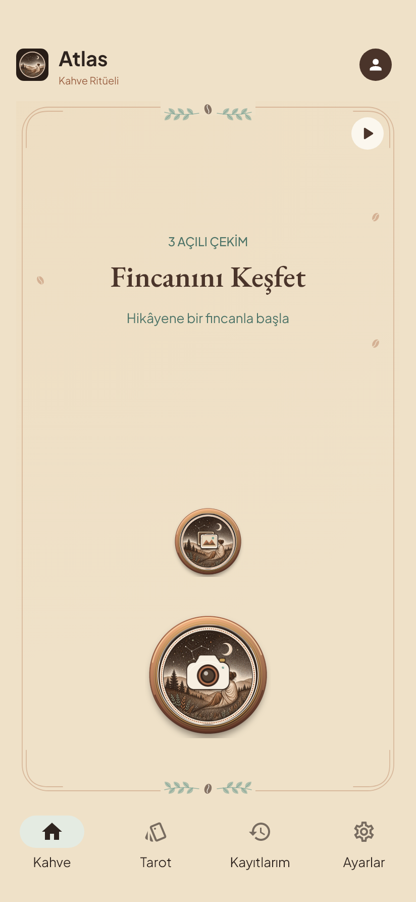
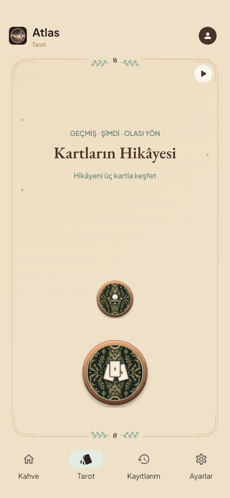

# Uİ SON karar

30 Ekim 2026. Kahve ve Tarot arayüzünün onaylanan son halinin kaynak kaydıdır.

- Dal: `codex/ui-son-karar`
- Geri dönüş etiketi: `ui-son-karar-v118`
- Temel: `2cc3308` (V111 arayüz kaydı). Bu dal arayüz, rehber, ilgili testler ve görsel varlıkların güncel halini içerir. Yerelde ayrıca bulunan AI sözleşmesi/prompt/gateway çalışmaları bu arayüz kaydının dışında korunmuştur.
- Alt gezinme: **Kahve · Tarot · Kayıtlarım · Ayarlar**. Simge, sıra ve gezinme davranışı aynı.
- Sıcak parşömen `#EFE1C8`, halesiz ana ekran, mevcut yuvarlak WebP tuşlar ve EB Garamond başlıklar.
- Tuş görselleri arası normal açıklık 34 dp; büyük görsel altından çerçeveye 58 dp. Geçici isimler tuşları kaydırmaz; büyük yazı ve kısa/yatay ekranlar kaydırmayı destekler.
- İsimler her uygulama oturumunda sayfanın ilk tamamlanan görünür ziyaretinde 6 saniye gösterilir, 400 ms'de kaybolur. Ayarlar anahtarı otomatik gösterimi kapatır; uzun basma ilgili ismi göstermeyi sürdürür. Ekran okuyucu isimleri kalıcıdır.
- Açılışın mevcut sesli videosu korunur. Poster ve ilk raster hazır olduktan sonra 1 saniyede belirme başlar; video paralel hazırlanır. Ana sahne kesilmeden/esnetilmeden ekranın kalan kenarları kendi dokularıyla tamamlanır.
- Çekirdekler/yıldızlar başlık çevresinde; üst çerçeve yaprakları 4 dp aşağıda. Diğer ekranların dekorları korunur.

## Doğrulama

Bu GitHub ağacının bağımsız kopyasında **268 senaryo geçti; Flutter analizi temiz**. Bir isteğe bağlı video dışa aktarma testi atlandı. Normal/2× yazı, dört ekran boyutu ve ▶ açık/kapalı için 32 ana ekran görünümü karşılaştırıldı. Kaynak ve telefon kurulumu sonuçları `validation.json` dosyasında kaydedilir.

| Kahve | Tarot |
| --- | --- |
|  |  |

[Kahve açıklamaları görünür](coffee-hints-on.png) · [Tarot açıklamaları görünür](tarot-hints-on.png) · [Kahve büyük yazı](coffee-large-text.png) · [Tarot büyük yazı](tarot-large-text.png)

Bu klasördeki görüntüler gerçek Flutter render'larıdır. Telefonun özgün sistem yazı/ekran ayarları kurulum sırasında korunur. AI, kamera ve kayıt davranışları bu görsel kaydın konusu değildir.

## Kaynağı kullanma

```powershell
git clone --branch ui-son-karar-v118 https://github.com/tongucaigo-alt/Coffee-Vision-Engine.git Atlas-UI-Son-Karar
cd Atlas-UI-Son-Karar/atlas_contribution_app
flutter pub get
```

Flutter 3.44.6 / Dart 3.12.2 kullanıldı. Yerel telefon paketi `lib/offline_main.dart` ve artan sürüm kodu üzerinden, mevcut özel yapılandırmayla hazırlanır. Bu dalın iş mantığı tabanı V111'dir; farklı iş mantığı çalışmaları olan bir projede yalnız `ui-files.json` listesindeki arayüz değişiklikleri aktarılmalıdır.

Özel test APK'sı, servis/sağlayıcı anahtarları, imzalama dosyaları, kullanıcı kayıtları ve özel cihaz yedekleri GitHub'a eklenmez.
