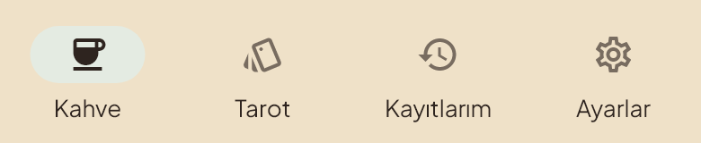

# UI SON KARAR — V127

3 Kasım 2026. Telefona veri koruyan güncelleme olarak kurulan son arayüz kaynakları.

- Alt gezinmedeki **Kahve** sekmesi artık ev yerine kahve fincanı kullanır. Seçili/seçili olmayan simgeler ve rehberdeki örnek tutarlıdır; sekmenin adı ve görevi aynıdır.
- Son onaylı video: sabit kamera, yukarı bakan kadın, doğal göl/yansıma, belirginleşen bulut hareketi ve sırayla parlayan Orion yıldızları.
- Kapanış son 800 ms içinde kenarlardan parşömene çözülür ve **fincana** odaklanır. Ardından mevcut ekran yumuşakça belirir. Tuş açıklamaları ekran görünür olduktan sonra tam altı saniye gösterilir.
- Eski AAC sesi, düşük ses seviyesi, sessiz mod, dokunarak geçme, hata ve hareket azaltma davranışları korunur.
- Kamera, AI, Tarot ve kayıt akışları değişmez. Önceki V120 performans ve V121 kamera düzeltmeleri tam depo tabanında korunur; yedi kardeş runtime paketinde 358 dosya önceki kaynakla eşleşir.



## Doğrulama

Fincan simgesi değişikliğinde gezinme ve rehber için iki mevcut test geçti; Flutter analyze temiz. Son video ile 54 açılış/geçiş testi, geçiş kodu için 105 ilgili regresyon testi geçti (isteğe bağlı eski video dışa aktarımı atlandı). Gerçek Flutter görüntüleri dört ekran boyutunda normal/büyük yazıyla incelendi.

V127 aynı imzayla mevcut test uygulamasının üzerine kuruldu. Kullanıcı kayıtları ve ilk kurulum tarihi korundu; gerçek Android soğuk açılışı Kahve ekranına ulaştı. Fatal veya video çözücü hatası görülmedi. Ayrıntılar [validation.json](validation.json) dosyasında.

Video 1080×2400, 24 fps, 6 saniyedir. Kaynak [uygulama videosu](../../../atlas_contribution_app/assets/intro/atlas-welcome.mp4) ve aynı videodan alınan posterleri içerir.

## Geri dönüş

Bu sürüm: `v127-ui-son-karar`; önceki sabit yedek: `v125-natural-intro-stable`.

Temiz bir checkout üzerinde:

```sh
git switch -c codex/restore-v127 v127-ui-son-karar
```

Yerel çalışmaları reset/clean ile silmeyin. Flutter uygulaması `atlas_contribution_app` içindedir; mevcut yerel özel yapılandırma ile derlenir. Özel test APK’sı, API anahtarları, imza dosyaları, telefon yedekleri ve kullanıcı kayıtları GitHub’a yüklenmedi. Ana dal ve önceki geri dönüş etiketleri değiştirilmedi.
